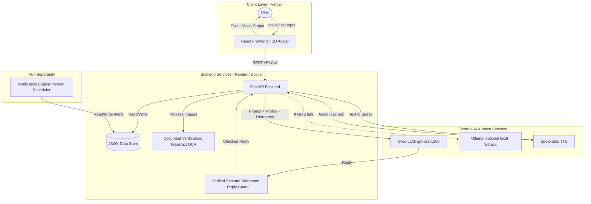
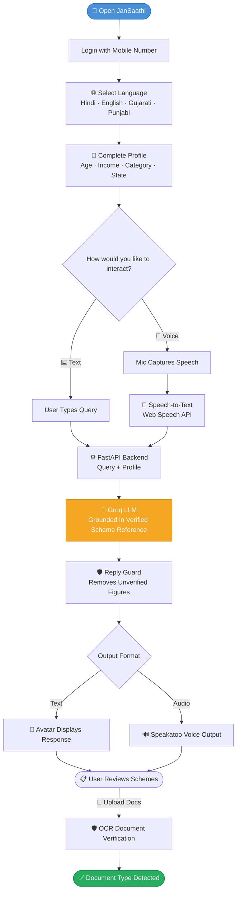

<div align="center">

# 🏛️ JanSaathi

### AI-Powered Citizen Assistance Platform

*Helping Indian citizens discover government schemes through multilingual, voice-first AI*

<br/>

[](https://jansaaathi.vercel.app/)
[](https://www.youtube.com/watch?v=dYWcx63Uz8A)


</div>

---

## 🎬 Demo

| | Link |
|---|---|
| 🌐 **Live App** | **[jansaaathi.vercel.app](https://jansaaathi.vercel.app/)** |
| 🎥 **Video Demo** | **[Watch on YouTube](https://www.youtube.com/watch?v=dYWcx63Uz8A)** |

> ℹ️ The backend runs on Render's free tier and sleeps when idle, so the **first request can take up to a minute**.

---

## 📖 Overview

**JanSaathi** *(Jan = People, Saathi = Companion)* is a citizen assistance platform built to bridge the gap between government welfare schemes and the people they serve.

- 🎤 Users interact via **voice or text** in their preferred language
- 🧠 An **LLM via Groq** (`openai/gpt-oss-120b`) answers questions and recommends schemes, grounded in a **verified reference of 21 central schemes**
- 👤 A **3D talking avatar** provides a conversational, accessible interface
- 🌐 Currently supports **Hindi, English, Gujarati, and Punjabi**

> ⚠️ This project is under active development. Features marked 🚧 are not yet available.

---

## ✅ Implemented Features

| Feature | Description |
|---|---|
|  **Voice Input** | Speech-to-text via the browser's Web Speech API |
|  **Voice Output** | Natural Indian-language voices via Speakatoo TTS (cached on the server), with browser speech as a fallback |
|  **4-Language Support** | Hindi, English, Gujarati, and Punjabi across UI, chat, and voice |
|  **3D Avatar (Saathi)** | GLB avatar with lip-sync, rendered with Three.js via TalkingHead |
|  **AI Chat** | Scheme questions answered by Groq LLM; Ollama can be used as a local fallback |
|  **Scheme Personalization** | AI-matched schemes based on age, income, category, occupation, and state |
|  **Answer Safeguards** | Official scheme names and links; figures not in the verified reference are removed automatically; in-app disclaimer |
|  **Document Verification** | Image upload with Tesseract OCR that detects Aadhaar cards and income certificates, plus AI document checks |
|  **Login** | Mobile-number sign-in kept in the browser (no OTP verification yet) |
|  **Notification Engine** | Standalone Python scheduler for scheme alerts and reminders (run separately; not part of the hosted demo) |

---

## 🚧 Planned Features

| Feature | Description |
|---|---|
|  **Full RAG Pipeline** | Scheme retrieval using Qdrant vector DB + document embeddings |
|  **Airavata + IndicTrans** | Production-grade Indic language translation |
|  **Bhashini TTS** | Government-backed Indian language speech synthesis |
|  **vLLM Inference** | Scalable, multi-user LLM serving |
|  **PostgreSQL + Redis + Qdrant** | Full production database architecture |
|  **Per-User Accounts** | OTP-verified login with separate profiles and chat history |
|  **WhatsApp Notifications** | Scheme deadline alerts via WhatsApp |
|  **Production Cloud** | Tata Cloud / hybrid infrastructure |
|  **More Languages** | Tamil, Telugu, Bengali, Marathi, and others |

---

## 🏗️ Architecture Diagram



---

## 🔄 User Flow Diagram



---

## ⚙️ Tech Stack

<br/>

**Frontend**

| Technology | Purpose |
|---|---|
| React 19 + TypeScript | UI framework |
| Vite | Build tool and dev server |
| Tailwind CSS + Motion | Styling and animation |
| Three.js + TalkingHead | 3D GLB avatar with lip-sync |
| react-markdown + remark-gfm | Formatted chat replies |
| Web Speech API | Voice input (and fallback voice output) |

<br/>

**Backend**

| Technology | Purpose |
|---|---|
| FastAPI (Python) | REST API server |
| Pydantic v2 | Data validation and schemas |
| Tesseract + pytesseract + Pillow | OCR for document verification |
| JSON file store | Lightweight data persistence |
| Docker | Deployment image (includes Tesseract) |

<br/>

**AI / Voice**

| Technology | Status | Purpose |
|---|---|---|
| Groq — `openai/gpt-oss-120b` | ✅ Current | LLM for chat, scheme matching, document checks |
| Ollama — Llama 3.2 | ✅ Optional | Local fallback when Groq is unavailable |
| Speakatoo | ✅ Current | Indian-language text-to-speech |
| Web Speech API | ✅ Current | Voice input; fallback voice output |
| Bhashini TTS | 🚧 Planned | Production Indic TTS |
| Airavata + IndicTrans | 🚧 Planned | Indic language translation |
| vLLM | 🚧 Planned | Scalable inference |
| Qdrant | 🚧 Planned | Vector search for RAG |

<br/>

**Hosting**

| Service | Purpose |
|---|---|
| Vercel | Frontend |
| Render (Docker) | Backend |

---

## 🌐 Supported Languages

| Language | Code | UI | Voice Input (STT) | Voice Output (TTS) |
|---|---|---|---|---|
| English  | `en` | ✅ | ✅ | ✅ |
| Hindi    | `hi` | ✅ | ✅ | ✅ |
| Gujarati | `gu` | ✅ | ✅ | ✅ |
| Punjabi  | `pa` | ✅ | ✅ | ✅ |

> 🚧 Tamil, Telugu, Bengali, and Marathi support is planned for future releases.

---

## 🚀 Setup & Installation

> Run the **backend** and **frontend** in two terminals.

<br/>

### Prerequisites

- Python **3.11 or 3.12** (the pinned Pillow version has no wheels for 3.13+)
- Node.js **18+**
- **Tesseract OCR** for document upload
  - Ubuntu/Debian: `sudo apt-get install tesseract-ocr`
  - macOS: `brew install tesseract`
  - Windows: [installer](https://github.com/UB-Mannheim/tesseract/wiki)
- A **Groq API key** ([console.groq.com](https://console.groq.com/))
- **Speakatoo** credentials for voice output (optional; the browser voice is used without them)

<br/>

### ⚙️ Terminal 1 — FastAPI Backend

```bash
cd backend
cp .env.example .env        # then fill in GROQ_API_KEY and SPEAKATOO_* values
python -m venv .venv
source .venv/bin/activate   # Windows: .venv\Scripts\activate
pip install -r requirements.txt
uvicorn app.main:app --reload --port 8000
```

> API docs available at `http://localhost:8000/docs` · health check at `http://localhost:8000/api/health`

<br/>

### 🌐 Terminal 2 — React Frontend

```bash
cd frontend
cp .env.example .env        # VITE_API_URL=http://localhost:8000
npm install
npm run dev
```

> App available at `http://localhost:3000`

<br/>

### 🧠 Optional — Local LLM fallback (Ollama)

```bash
ollama pull llama3.2
ollama serve
```

Used only if Groq is not configured or fails. Set `OLLAMA_BASE_URL` / `OLLAMA_MODEL` in `backend/.env` if they differ from the defaults.

<br/>

### 🔔 Optional — Notification Engine

```bash
cd notification-engine
python worker.py
```

---

## ☁️ Deployment

The live demo runs the **frontend on Vercel** and the **backend on Render** (Docker). Step-by-step settings, environment variables and known limits are in **[DEPLOY.md](DEPLOY.md)**.

---

## 📁 Folder Structure

```
Jansaathi/
│
├── frontend/                          # React + TypeScript frontend
│   ├── src/
│   │   ├── components/
│   │   │   ├── tabs/                  # Dashboard, Chat, Profile, Verify tabs
│   │   │   ├── ui/                    # Shared UI (ChatMarkdown, buttons, ...)
│   │   │   ├── layout/                # App layout
│   │   │   ├── GLBAvatar.tsx          # 3D talking avatar (TalkingHead)
│   │   │   ├── AuthScreen.tsx         # Mobile-number login
│   │   │   ├── LanguageSelect.tsx     # 4-language picker
│   │   │   ├── ProfileForm.tsx        # Multilingual profile form
│   │   │   ├── SchemeList.tsx         # Scheme recommendation cards
│   │   │   └── NotificationPanel.tsx  # Alerts and reminders UI
│   │   ├── config/api.ts              # Backend URL (VITE_API_URL)
│   │   ├── hooks/                     # useChat, useAppState
│   │   ├── services/
│   │   │   ├── api.ts                 # Backend API client
│   │   │   ├── tts.ts                 # Voice output + speech recognition
│   │   │   └── storage.ts             # LocalStorage persistence
│   │   ├── types.ts                   # TypeScript types
│   │   └── App.tsx                    # Main app flow
│   ├── public/avatar.glb              # Avatar model
│   ├── .env.example
│   └── package.json
│
├── backend/                           # FastAPI Python backend
│   ├── app/
│   │   ├── api/                       # chat, schemes, verify, tts, profile,
│   │   │                              # notifications, health endpoints
│   │   ├── services/
│   │   │   ├── ai.py                  # Groq / Ollama integration + prompts
│   │   │   ├── scheme_reference.py    # Verified scheme names, figures, links
│   │   │   ├── reply_guard.py         # Removes unverified figures from replies
│   │   │   └── ocr_service.py         # Tesseract document detection
│   │   ├── models/models.py           # Pydantic models
│   │   ├── utils/storage.py           # JSON file store
│   │   └── main.py                    # FastAPI entry point (CORS from env)
│   ├── data/                          # Runtime data + TTS cache (not committed)
│   ├── Dockerfile
│   ├── .env.example
│   └── requirements.txt
│
├── notification-engine/               # Standalone notification scheduler
│   ├── worker.py                      # Main worker loop
│   └── scheduler.py                   # Schedule rules
│
├── DEPLOY.md                          # Vercel + Render deployment guide
└── README.md
```

---

## ⚠️ Limitations

- **AI can still make mistakes** — Answers are grounded in a verified reference of 21 central schemes and unverified figures are removed, but wording can be wrong and other schemes rely on the model's own knowledge. Users are told to confirm on official sites.
- **No RAG pipeline yet** — Scheme facts live in a hand-maintained file (`scheme_reference.py`) rather than a searchable, regularly updated database.
- **Groq free-tier limits** — About 8,000 tokens per minute (roughly 3–4 chat messages per minute across all users).
- **Shared demo data** — All visitors currently share one profile and chat history on the server.
- **No persistent database** — Data is stored in JSON files; on Render's free tier it resets on every deploy.
- **Basic login** — The mobile number is not verified (no OTP).
- **Partial document verification** — OCR detects Aadhaar cards and income certificates only; full eligibility checks are incomplete.
- **Browser-dependent voice input** — Speech recognition quality varies across browsers and devices.
- **4 languages only** — Only Hindi, English, Gujarati, and Punjabi are supported today.

---

## 🔮 Future Scope

- 📚 **RAG pipeline** with Qdrant to serve up-to-date, retrieved scheme information
- 🔊 **Bhashini TTS** for production-quality Indic voice output
- 🌏 **Airavata + IndicTrans** for all 22 scheduled Indian languages
- ⚡ **vLLM** for high-throughput, concurrent LLM serving
- 🗄️ **PostgreSQL + Redis + Qdrant** for full production data architecture
- 🔐 **OTP login** with per-user profiles and history
- 📱 **WhatsApp integration** for scheme deadline alerts and status updates
- ☁️ **Production cloud** on Tata Cloud or hybrid infrastructure
- 🗣️ **Expanded language support** — Tamil, Telugu, Bengali, Marathi

---

## 👩‍💻 Author

<div align="center">

**JanSaathi** — Built to make government welfare schemes accessible to every Indian citizen.

[](https://github.com/GhiyadShreya/Jansaathi)
[](https://jansaaathi.vercel.app/)

<br/>

*🇮🇳 Bridging citizens and government — one conversation at a time.*

</div>
